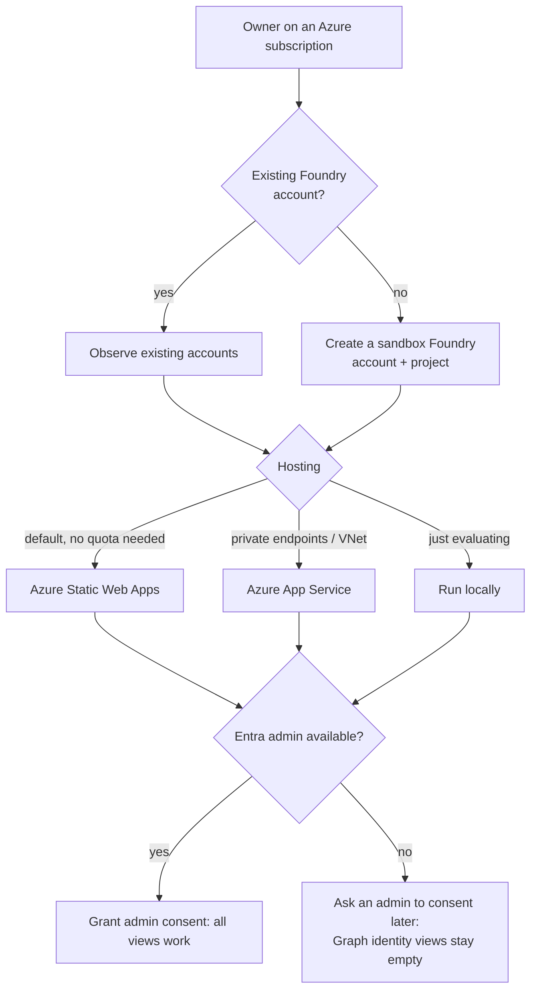

# Getting started

Deploying agentctl takes three decisions and about 30 minutes.

| Decision | Recommendation |
|---|---|
| **Foundry** | Point at your existing Foundry accounts (`foundry.existing_account_ids`). To try agentctl in an empty subscription, let Terraform create a sandbox account and project. |
| **Hosting** | **Static Web Apps (Free)** unless you need private networking. App Service needs VM quota (new pay-as-you-go subscriptions often have none) but supports VNet integration. See [Deploy](../deploy/index.md). |
| **Admin consent** | agentctl reads directory data (app registrations, grants, agent identities) through delegated Graph permissions that need tenant admin consent. Without it, everything else works. See [Permissions](permissions.md#entra-id). |

Next: [Prerequisites & tooling](prerequisites.md). If your Azure platform is already managed in Terraform, read [Add to existing Terraform](../deploy/existing-terraform.md) next.
