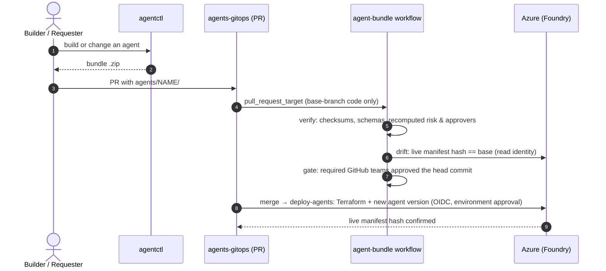

# Agents GitOps repo

agentctl never writes to Foundry. Every agent creation or change is a **bundle**: manifest, change request, Foundry payload, Terraform and checksums. A bundle is merged into your **private agents-gitops repo**, which verifies and deploys it.

| Check | Fails when |
|---|---|
| **verify** | a file was edited after export; schema invalid; declared risk or approvers lower than recomputed; payload doesn't match the manifest; PR deletes an agent or mixes platform files with bundles |
| **drift** | the live agent changed since the bundle was built (or a "create" targets an existing agent) |
| **gate** | a required approver group (owners, platform-security, identity-admins) hasn't approved the **latest commit**. For updates, owners come from the *current* manifest, so nobody can add themselves as owner and approve their own change |
| **deploy** | Terraform or the agent apply fails, or the live manifest hash doesn't match after deploy |

Next: [Set up your private repo](setup.md).
