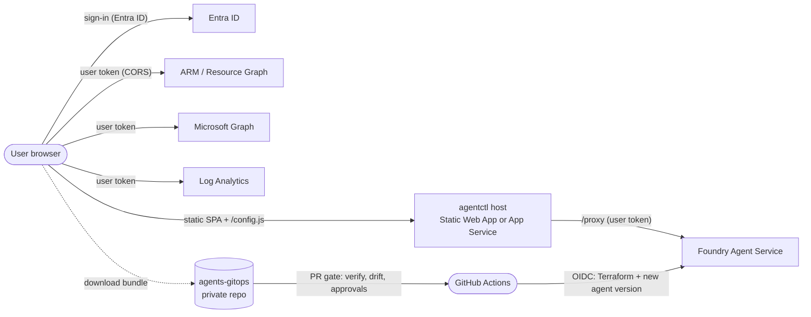

---
hide:
  - navigation
---

# agentctl

**An agent control plane for Azure AI Foundry.** See every agent, who uses it and with what authority. Check every agent against 50 AI risk controls. Change agents safely through GitOps.

- :material-rocket-launch: **[Deploy in 30 minutes](deploy/quickstart.md)**

    ---

    With **Owner on one subscription**: Terraform, then the latest release to Azure Static Web Apps.

- :material-source-branch: **[Set up your agents repo](gitops/setup.md)**

    ---

    A private GitHub repo from the release template: verified, drift-checked, approval-gated deploys.

- :material-shield-check: **[AI risk controls](CONTROLS.md)**

    ---

    OWASP LLM & Agentic Top 10, NIST AI RMF, ISO 42001, EU AI Act, MITRE ATLAS, MCSB, evaluated live.

- :material-account-key: **[Permissions](getting-started/permissions.md)**

    ---

    Exactly which Azure RBAC and Entra rights each step needs, and what to do without an Entra admin.

## What it does

| Area | What you get |
|---|---|
| **Observe** | Inventory of Foundry agents across subscriptions; runs, tool calls, tokens and failures from App Insights; who calls agents (delegated, on-behalf-of, app-only, managed identity, Entra Agent ID) |
| **Govern** | Guardrail posture (content filters, prompt shields), Azure Policy, Defender for AI, findings with one-click fixes, and **50 AI risk controls** scored per framework and per agent |
| **Change** | Agent builder and *harness injection* (extra tools with approval, platform instructions, tighter guardrails). Every change is a signed-off **bundle** that a GitOps pipeline verifies and deploys |
| **Scope** | App roles (Reader, Identity Reader, Requester, Builder, Approver, Admin) and data scopes that limit teams to their Foundry projects, enforced by Azure RBAC |

## How it fits together

- **No credentials in agentctl.** Every Azure call uses the signed-in user's own token, so people see only what Azure RBAC lets them see. The host only serves files, runtime configuration and an allowlisted pass-through to Foundry, which doesn't support browser CORS.
- **Changes don't go straight to production.** agentctl produces bundles; your private **agents-gitops** repo verifies and deploys them with OIDC.

## Where to start

1. Read [Prerequisites & tooling](getting-started/prerequisites.md) and [Permissions](getting-started/permissions.md) (5 minutes).
2. Follow the [Quickstart](deploy/quickstart.md) to deploy the latest release ({{ version }}).
3. [Set up your agents repo](gitops/setup.md) when you're ready to change agents through GitOps.

!!! tip "Try it without Azure"
    Clone the repo and run `cd app && npm install && npm run dev`. Mock mode has a seeded tenant with 8 agents, findings and controls. See [Run locally](deploy/local.md).
